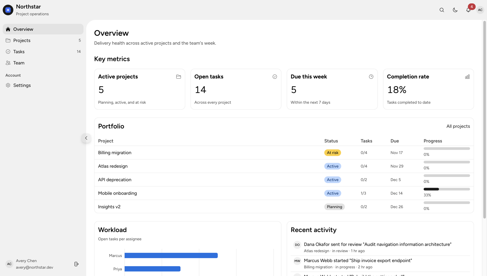
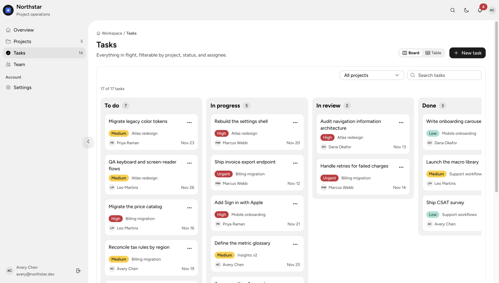
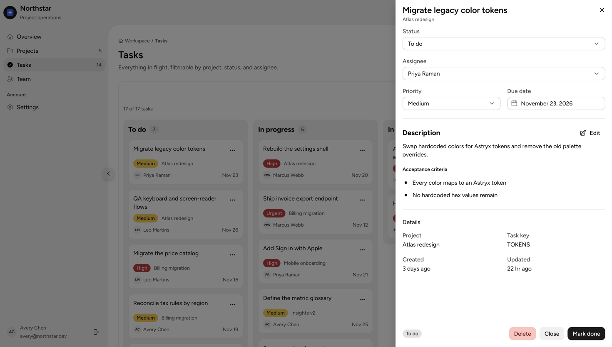
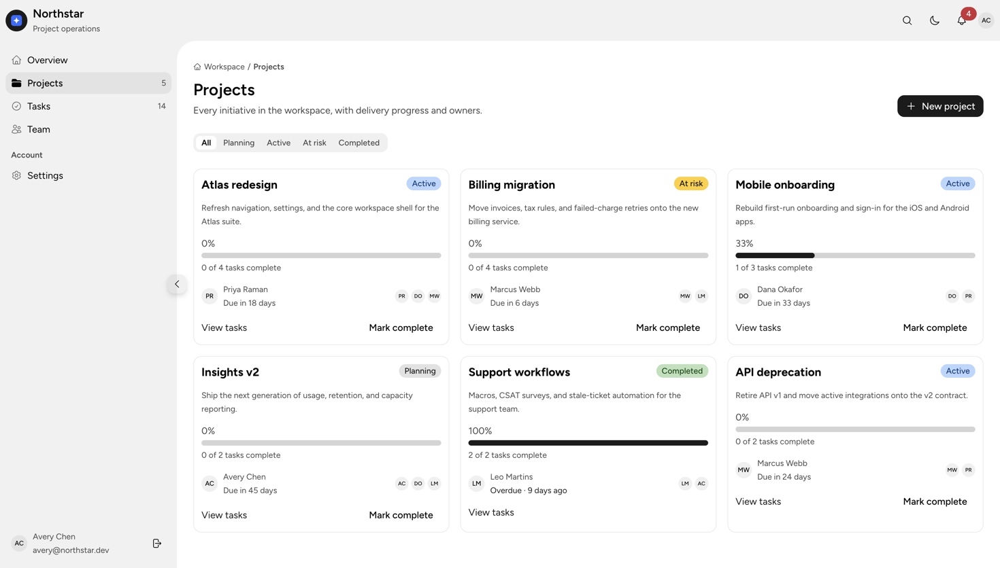
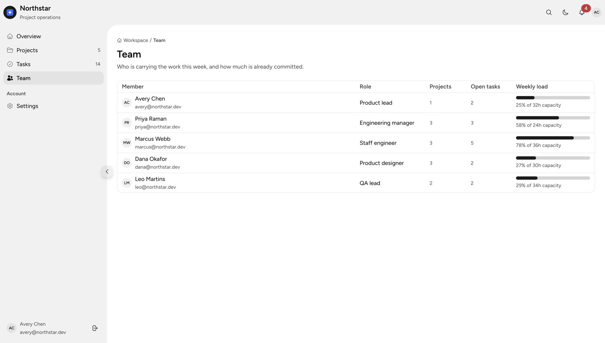
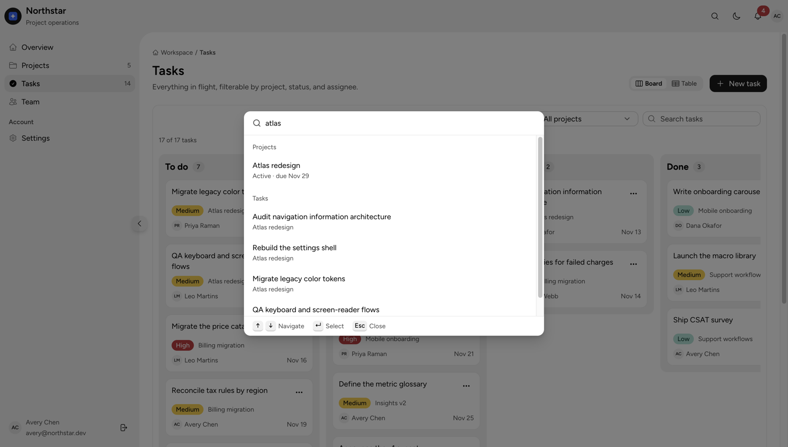
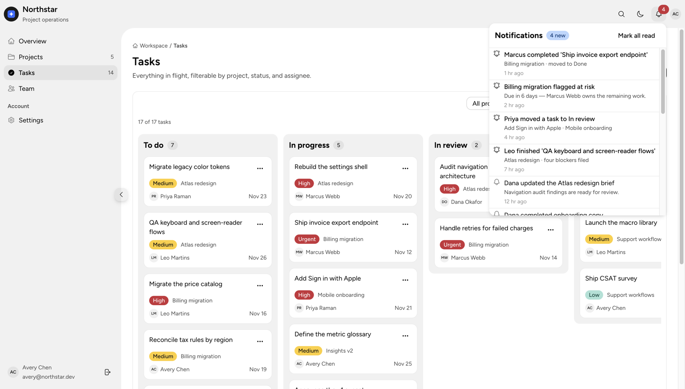
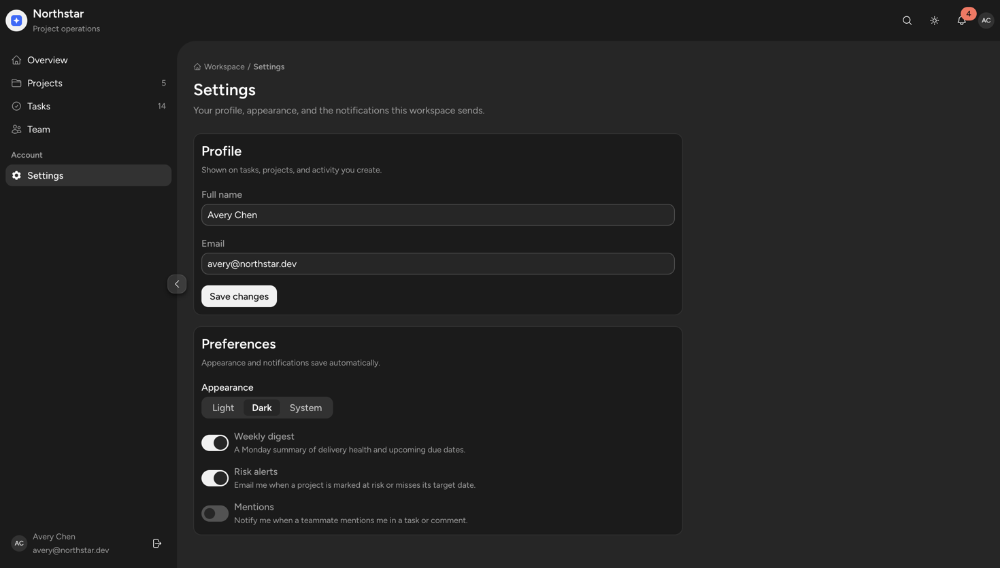
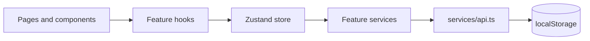

# Northstar Dashboard

A project-operations dashboard template built with **React 19**, **TypeScript**, **Vite**, and Meta's [Astryx](https://astryx.atmeta.com) design system. Plan projects, run a kanban board, manage tasks with rich descriptions, track team capacity, and stay on top of activity — all with a real, persisted demo dataset and no backend.

[](https://react.dev)
[](https://www.typescriptlang.org)
[](https://astryx.atmeta.com)
[](https://vite.dev)
[](https://pnpm.io)
[](#quality)



## Highlights

- **App shell** — Astryx `AppShell` with TopNav, collapsible SideNav, breadcrumbs, theme switch, notifications, and a sidebar/content collapse handle.
- **Kanban + table** — drag tasks between status lanes or switch to a paginated table; project/status/search filters with URL deep links.
- **Task drawer** — Jira-style detail panel with editable status, assignee, priority, due date, a Tiptap rich-text description stored as Markdown, creation/update metadata, and a confirmed delete.
- **Global search** — `⌘K` / `Ctrl+K` command palette over navigation, projects, and tasks; selecting a task deep-links and opens its drawer.
- **Notifications** — bell with unread badge, scrollable tray, per-item read state, and “mark all read”.
- **Polished states** — shimmer skeletons for lazy routes, spinners, toasts with undo, empty states with next actions, destructive `AlertDialog`.
- **Theming** — light, dark, and system modes persisted per user; Astryx tokens throughout, no hardcoded palette.
- **Demo persistence** — projects, tasks, sessions, inbox, and preferences survive reloads via a swappable storage transport.

## Screenshots

### Task board and detail

| Kanban board                                                           | Task detail drawer                                                            |
| ---------------------------------------------------------------------- | ----------------------------------------------------------------------------- |
|  |  |

### Projects and team

| Projects                                                                 | Team capacity                                             |
| ------------------------------------------------------------------------ | --------------------------------------------------------- |
|  |  |

### Search, inbox, and dark mode

| Global search                                                                       | Notifications                                                              |
| ----------------------------------------------------------------------------------- | -------------------------------------------------------------------------- |
|  |  |



## Quick start

**Requirements:** Node 20+ and pnpm 10+.

```bash
pnpm install
pnpm dev
```

Open http://localhost:5173 and sign in with the demo account:

| Email                 | Password   |
| --------------------- | ---------- |
| `avery@northstar.dev` | `demo1234` |

Any 6+ character password is accepted — authentication is a local demo, not a credential store.

## Stack

| Layer     | Choice                                                     |
| --------- | ---------------------------------------------------------- |
| UI        | React 19, Astryx 0.7 (`@astryxdesign/core`, theme-neutral) |
| Routing   | React Router 7                                             |
| State     | Zustand store with feature slices                          |
| Rich text | Tiptap 3, marked, Turndown (Markdown storage)              |
| Charts    | Recharts 3                                                 |
| Build     | Vite 8, TypeScript, pnpm                                   |
| Quality   | Oxlint, Prettier, Vitest + jsdom                           |

## Scripts

| Command          | Purpose                                     |
| ---------------- | ------------------------------------------- |
| `pnpm dev`       | Start the Vite dev server                   |
| `pnpm build`     | Typecheck, then build to `dist/`            |
| `pnpm preview`   | Preview the production build                |
| `pnpm typecheck` | `tsc --noEmit`                              |
| `pnpm lint`      | Oxlint                                      |
| `pnpm test`      | Vitest (utilities + service workflow)       |
| `pnpm format`    | Prettier write                              |
| `pnpm astryx`    | Astryx CLI (`pnpm astryx component Button`) |

## Project structure

```
src/
  assets/                 brand mark, empty-state illustration, fonts note
  components/
    common/               PageHeader, PageBreadcrumbs, MetricCard, StatusBadge,
                          EmptyState, Modal, PageSkeleton, RichTextEditor
    layout/               Header (TopNav), Sidebar, AppShellLayout
  context/                AuthProvider, ThemeProvider
  features/
    auth/                 SignInForm
    dashboard/            KPI grid, portfolio, workload chart, activity feed
    notifications/        NotificationBell, service, hook
    profile/              ProfileForm, PreferencesForm
    projects/             ProjectCard, ProjectFormDialog, useProjects, service
    search/               GlobalSearch command palette
    tasks/                TaskBoard, TaskTable, TaskDetailDrawer,
                          TaskFormDialog, filters, hooks, service
    team/                 TeamTable, useTeam
  hooks/                  useAuth, useThemeMode, useDebounce, useLocalStorage
  pages/                  Login, Overview, Projects, Tasks, Team, Settings, NotFound
  routes/                 AppRoutes, ProtectedRoute, lazy page map
  services/               api (storage transport), authService, userService
  store/                  Zustand store + slices
  styles/                 globals.css, token aliases, theme mode helpers
  types/ utils/ config/   domain types, helpers, env/app config
docs/screenshots/         README imagery
tests/                    integration tests
```

## Architecture



Data flows one way: feature services shape entities and persist them through `services/api.ts`; store slices keep the in-memory copy and call those services; hooks join entities for views; pages compose components. To connect a backend, replace the three `storage` methods in `src/services/api.ts` with HTTP calls — pages, hooks, and components stay unchanged.

## Feature notes

### Theming

`ThemeProvider` passes the generated Astryx theme once and controls `mode` (`light`, `dark`, `system`), persisted in local storage. Extend the theme without forking:

```ts
import { defineTheme } from '@astryxdesign/core/theme';
import { neutralTheme } from '@astryxdesign/theme-neutral/built';

export const brandTheme = defineTheme({
  extends: neutralTheme,
  name: 'northstar',
  tokens: { '--color-accent': ['#0F62FE', '#7AA2FF'] },
});
```

### Rich text

Descriptions are Markdown. The shared editor uses Tiptap with bold, italic, heading, list, quote, and code controls; Turndown serializes edits and Astryx `Markdown` renders the read view. `⌘↵` / `Ctrl+Enter` saves while editing.

### Keyboard shortcuts

| Shortcut            | Action                               |
| ------------------- | ------------------------------------ |
| `⌘K` / `Ctrl+K`     | Open global search                   |
| `⌘↵` / `Ctrl+Enter` | Save description in the editor       |
| `Esc`               | Close drawers, dialogs, and popovers |

### Demo data

Seeded projects, tasks, team members, and notifications live in the feature services. State is stored under `northstar.*` keys. To reset the demo, clear those keys in DevTools and reload — the app reseeds automatically.

## Quality

```bash
pnpm format:check
pnpm typecheck
pnpm lint
pnpm test
pnpm build
pnpm astryx doctor --built .
```

The suite covers validation rules, date/countdown helpers, task creation/update/delete, and project persistence. Components rely on Astryx for accessible patterns (landmarks, focus management, alert dialogs, command palette keyboard behavior).

## Deployment

`pnpm build` emits a static SPA in `dist/`. Deploy to any static host with an SPA fallback to `index.html` (Netlify redirects, Vercel rewrites, or S3 + CloudFront). No runtime environment variables are required beyond the optional `VITE_APP_NAME` and `VITE_STORAGE_PREFIX`.

## Design notes

- `index.html` stays at the repository root — Vite requires the entry HTML there.
- Linting uses Oxlint; there is no ESLint config.
- Astryx ships component styles, so there are no per-page CSS modules; app-level CSS is limited to `src/styles/globals.css` and small layout classes.
- `src/astryx-themes.js` is generated by the Astryx CLI and must not be edited by hand.

---

Built as a template. Add your own license before distributing.
